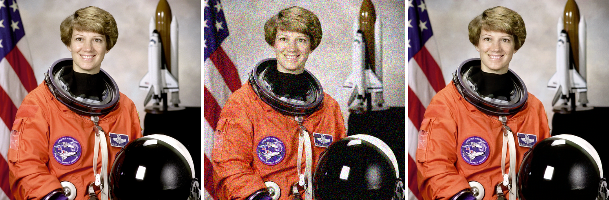
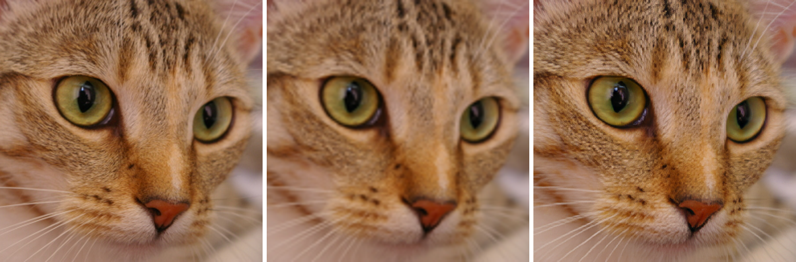

# 图像恢复复现实验

整理图像恢复方向的代码、真实实验结果、结果分析和实验感悟。最新实验为 **PixRestore（2026）预训练单步推理复现**，使用作者公开权重，在本机 RTX 3060 Laptop 上完成 4 张图 × 3 种退化 × 3 个模型随机种子的测试。

## 项目入口

| 项目 | 代码与运行 | 结果 | 分析与感悟 |
|---|---|---|---|
| PixRestore · 2026 | [复现说明](experiments/pixrestore/README.md) | [逐图指标](experiments/pixrestore/results/metrics.csv) · [配置与汇总](experiments/pixrestore/results/summary.json) | [结果分析](experiments/pixrestore/RESULTS_ANALYSIS.md) · [实验感悟](experiments/pixrestore/REFLECTIONS.md) |
| DDRM · 2022 | [复现说明](experiments/ddrm/README.md) | [逐图指标](experiments/ddrm/results/metrics.csv) · [图像对比](experiments/ddrm/results/figures/comparison_all.png) | [结果分析](experiments/ddrm/RESULTS_ANALYSIS.md) · [实验感悟](experiments/ddrm/REFLECTIONS.md) |

## PixRestore 最新结果

以下为主 base seed=20261116 时四图均值，评价完整 512×512 RGB 浮点结果；JPEG 是论文八任务之外的额外检查。数据由公开样例中心裁剪和缩放得到，部分 GT 存在上采样。

| 任务 | 输入 PSNR | 恢复 PSNR | ΔPSNR | 输入 SSIM | 恢复 SSIM |
|---|---:|---:|---:|---:|---:|
| 4×双三次超分 | 29.1804 | 28.2111 | -0.9693 | 0.863291 | 0.839130 |
| 高斯去噪 σ=25/255 | 20.6136 | 33.2621 | +12.6484 | 0.268898 | 0.901573 |
| JPEG Q=10 额外检查 | 28.5409 | 29.3894 | +0.8484 | 0.809112 | 0.849342 |

去噪和 JPEG 平均改善，超分四图中三图退步。保留所有结果及失败样例，没有把小样本推理写成完整论文 benchmark 复现。单步恢复调用约 100 ms/图，含 DINO 特征提取，计时边界见 [分析](experiments/pixrestore/RESULTS_ANALYSIS.md)。

去噪案例 astronaut，依次为 GT、输入、PixRestore-S：

超分失败案例 chelsea，依次为 GT、双三次输入、PixRestore-S：

## 复现与核查

各实验目录提供固定源码版本、权重下载与哈希、环境、输入协议、推理脚本和 CPU 复核脚本。进入对应目录按 README 操作；已有输出可用 `python verify_results.py` 独立复算指标。

模型与方法来自原论文作者，本项目完成推理适配、测量、结果存档及分析。仓库保存代码、实验输入与结果、分析和感悟；论文 PDF、组会 PPT、讲稿和大模型权重不随仓库分发。不同项目的数据分辨率、退化和时延协议不同，表格不能直接跨项目排名。

[PixRestore 论文](https://arxiv.org/abs/2608.16793) · [官方代码](https://github.com/csslc/PixRestore) · [DDRM 官方项目](https://ddrm-ml.github.io/) · [第三方来源与许可](licenses/THIRD_PARTY_NOTICES.md)
