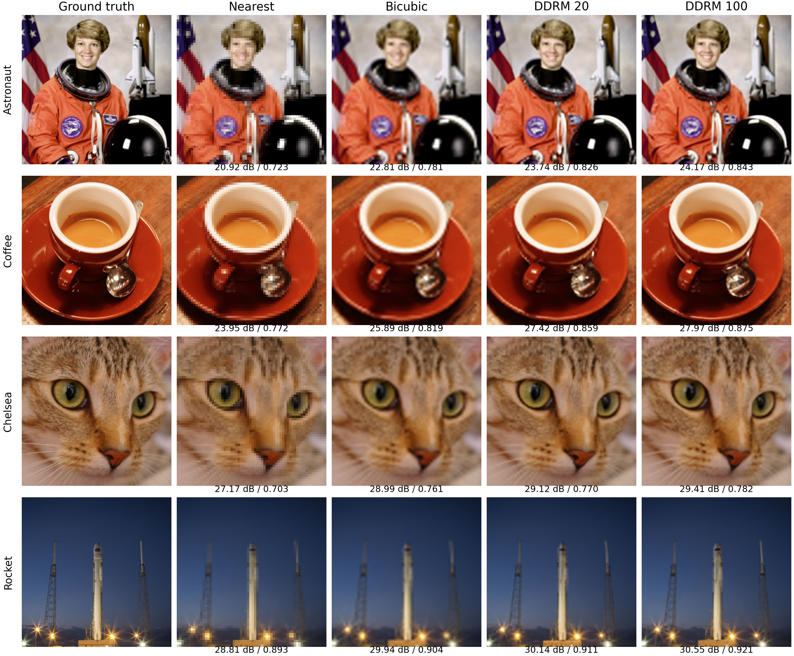

# DDRM：预训练扩散模型的小样本推理复现

论文：Kawar et al., **Denoising Diffusion Restoration Models**, NeurIPS 2022。

- 论文与项目：https://ddrm-ml.github.io/
- 官方源码：https://github.com/bahjat-kawar/ddrm
- 固定 commit：`32b6b3ccfda532ba01c9cc5b6e7456c3a06a6ca2`
- 权重：OpenAI 官方 `256x256_diffusion_uncond.pt`，原始下载 URL 和下载文件 SHA256 记录在 `checkpoint_manifest.json`（本次记录；重新下载时还会生成 `weights/manifest.json`）。

本项目直接调用官方采样器与 SVD 算子，使用现成 ImageNet 256×256 无条件扩散模型，未重新训练。任务是无观测噪声的 **4× block-average 超分辨率**：256×256 RGB → 64×64 RGB → 256×256 RGB。这里的退化是平均池化，bicubic 仅作为恢复基线。

本次只有 4 张公开图和有限随机种子，目的是验证算法流程、观察恢复质量及推理成本。**这不是原论文 ImageNet 1K benchmark 的完整复现，也不构成对论文表格指标的重现。**

[结果分析](RESULTS_ANALYSIS.md) · [实验感悟](REFLECTIONS.md)

## 实测结果

主随机种子下的 4 张图算术平均：

| 方法 | RGB PSNR ↑ | RGB SSIM ↑ | 平均推理时间 | NFE |
|---|---:|---:|---:|---:|
| Nearest | 25.2126 dB | 0.77256 | CPU 插值基线 | 0 |
| Bicubic | 26.9086 dB | 0.81623 | CPU 插值基线 | 0 |
| DDRM 20 | 27.6066 dB | 0.84165 | 4.9178 s | 20 |
| DDRM 100 | 28.0231 dB | 0.85514 | 24.6174 s | 100 |

DDRM 20 比 bicubic 平均提高 0.6980 dB。100 步比 20 步平均提高 0.4165 dB，耗时约为 5.01 倍。两种 DDRM 配置的 PyTorch 峰值分配显存均为 1578.67 MiB。这里是单次计时，不能推及其他硬件或完整数据集。

20 步额外运行两组种子，共 12 次恢复；三组“4 图平均值”之间为 **27.6621 ± 0.0517 dB、SSIM 0.841646 ± 0.000654**，± 为三个均值的样本标准差，不是置信区间。所有种子都保留，没有筛选最佳结果。



实验运行于 2026-11-09。独立审核从保存的浮点数组重算 PSNR、SSIM、测量一致性 RMSE，并核对 CSV/JSON 和 PNG 量化，均通过。

## 文件

- `prepare_inputs.py`：生成固定的 astronaut、coffee、chelsea、rocket 输入。
- `data/sources.json`：每张图来源、许可说明、中心裁剪坐标与 SHA256。
- `download_weights.py`：下载官方 2.21 GB 权重，支持分块恢复并校验字节范围。
- `run_experiment.py`：执行原样官方推理、nearest/bicubic 基线、逐图指标和性能记录。
- `make_figures.py`：从真实输出生成比较图。
- `verify_results.py`：无需GPU或模型权重，独立复算主实验的16行指标并核对存档。
- `results/metrics.csv`：主随机种子下逐图逐方法结果。
- `results/summary.json`：完整协议、环境、逐图结果和算术均值。
- `results/images/`：原图、64×64 观测、恢复图；`results/arrays/` 保存未量化浮点输出以便重算。
- `results_seed2/`、`results_seed3/`（若存在）：20 步额外随机种子实验，单独存储。

## 复现

建议新建 Python 3.10 环境安装 `requirements.txt`；本机实际使用已存在的 Python 3.10 / PyTorch 2.1.1+cu118 环境，不向该环境安装或升级包。RTX 3060 Laptop 6 GB，batch=1，UNet 使用官方 FP16 转换。

```powershell
./setup_official.ps1
python prepare_inputs.py
python download_weights.py
python run_experiment.py --steps 20 100 --seed 20261116 --output results
python make_figures.py
python run_experiment.py --steps 20 --seed 20261216 --output results_seed2
python run_experiment.py --steps 20 --seed 20261316 --output results_seed3
python summarize_seeds.py
```

只核查仓库已有主实验结果时，在安装依赖后执行 `python verify_results.py`。该脚本使用CPU，无需下载权重或上游源码，且不修改结果文件。

准备好输入与权重后，也可运行 `./run_experiments.ps1` 一次完成主实验、可视化和额外种子；可通过 `-Python` 指定解释器。

下载脚本会暂存分块，与最终权重合计约 4.42 GB；下载完成后可以自行移除 `weights/download_parts/` 以回收空间。GitHub 不需要提交这些权重或分块。

## 比较协议

4 张输入先中心裁成正方形，再用 Pillow bicubic 调整到 256×256，并固定成 RGB uint8 PNG。模型输入按官方约定从 `[0,1]` 转换为 `[-1,1]`。观测噪声标准差为 0；η=0.85、η_b=1；线性 β 从 0.0001 到 0.02，共 1000 个训练时刻。20 步取 `0,50,…,950`，100 步取 `0,10,…,990`，均沿用官方排程；NFE 实际等于步数。

每张图的随机种子为命令行 seed 加图像序号。比较 20/100 步时，对同一张图重设相同种子，但由于步数和随机数调用顺序不同，不能理解为完全相同采样轨迹。额外种子独立报告，禁止挑选最佳输出冒充同种子比较。

PSNR 与 SSIM 使用完整 256×256、RGB、浮点 `[0,1]`、不裁边，恢复结果在计算前裁到 `[0,1]`；SSIM 为 scikit-image 默认 7×7 均匀窗口。先计算浮点指标再将 PNG 四舍五入到 8 bit，因此从 PNG 重算会有微小差异。额外报告 `‖H(x̂)-y‖` 的逐像素 RMSE，分别给出裁剪前/后值。不会对输出另做数据一致性投影。采样器最后一步及输出裁剪可能使残差非零。

性能计时采用模型预热后、采样前后 CUDA 同步，包含官方采样器逐步将轨迹拷回 CPU 的开销，不包含载入权重、预处理、算指标与保存图片。峰值显存含已加载模型，单位 MiB；它是 PyTorch allocator 统计，不等于系统全部显存。每图单次推理，GPU 温度、功率和其他桌面负载会影响结果。CPU 基线计时仅是一次插值调用，不适合当成严格性能 benchmark。

## 适配与完整性

保持 `official_ddrm` 中的算法源码不变。外层 wrapper 替代原 CLI 与 ImageNet 数据加载器；设 batch=1；先在 CPU 载入 checkpoint 再移到 CUDA，避免瞬时复制两份 GPU 权重。FP16 是官方 imagenet_256.yml 原有设置。先验证官方 H 等于 `avg_pool2d(...,4)`，并检查输出有限值。

`run_config.json` 记录 Python、PyTorch、CUDA、GPU、库版本、固定 commit 和 checkpoint hash。种子已固定，禁用 TF32，使用 cuDNN deterministic 配置，但不同硬件/版本不保证逐 bit 相同。

## 数据来源与许可

astronaut 为 NASA 公有领域图；coffee 与 chelsea 的 scikit-image 文档注明摄影师以 CC0 发布；rocket 文档注明 SpaceX 发布到公有领域。每项完整说明保存在 `data/sources.json`。官方 DDRM 源码使用 MIT License，保留原版权信息；上游代码通过固定 commit 下载，来源和版权归原作者。
